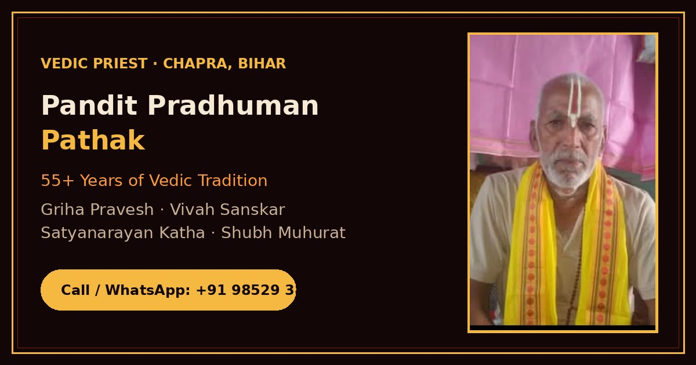

<div align="center">



# ॐ पंडित प्रद्युम्न पाठक — Vedic Priest, Chapra (Bihar)

**55+ Years of Authentic Vedic Tradition · Pure Sanskrit Chanting · Griha Pravesh, Vivah Sanskar & Shubh Muhurat**

*Made with devotion by his grandson **Raj Pathak***

[](https://react.dev/)
[](https://www.typescriptlang.org/)
[](https://vitejs.dev/)
[](https://tailwindcss.com/)
[](https://ai.google.dev/)
[](https://vercel.com/)

[✨ Features](#-key-features) • [🪔 Vedic Services](#-vedic-services-covered) • [🛠️ Tech Stack](#️-tech-stack) • [🚀 Quick Start](#-local-development) • [☁️ Deploy on Vercel](#️-deploying-on-vercel) • [📞 Contact](#-contact--service-area)

</div>

---

## 🪔 About This Project

This is the official bilingual (**Hindi / English**) web application for **Pandit Pradhuman Pathak**, a revered Vedic Priest & Jyotish Acharya in **Bin Toli, Bara Telpa, Chapra, Bihar**, carrying forward **55+ years of Shastra-compliant Vedic tradition** across Chapra and Saran district.

Designed with a warm **dark-saffron & sacred-gold** aesthetic, the site makes it effortless for families to explore rituals, check itemized Puja Samagri lists, ask an AI Samagri & Dakshina advisor, and book directly over **Phone or WhatsApp**.

---

## ✨ Key Features

| Feature | Highlights |
| :--- | :--- |
| 🌐 **Bilingual Hindi & English** | One-tap `हिं \| EN` switch with automatic `<html lang>` synchronization. |
| 🔥 **Sacred Havan Canvas** | Lightweight 24fps decorative fire & ember animation using cached offscreen sprites (`IntersectionObserver` + `prefers-reduced-motion` aware). |
| 📿 **10 Vedic Services & Samagri** | Category filters (`Sanskars`, `Pujas & Havan`, `Astrology & Gems`, `Muhurat`) + accessible detail modals with itemized Samagri checklists. |
| 💬 **Smart WhatsApp Booking** | Live Hindi/English message preview, Muhurat checkbox, one-click copy, and direct `wa.me` deep link. |
| 🤖 **AI Samagri & Dakshina Advisor** | Vercel Serverless Function (`/api/chat`) powered by **Gemini 2.5 Flash** with per-IP rate limiting, 32 KB payload cap, and Chapra local price estimates. |
| 📍 **Google Maps Integration** | Live map pin for Bin Toli, Bara Telpa, Chapra with one-tap Google Maps directions and graceful fallback card. |
| ♿ **WCAG 2.1 AA & Mobile-First** | Modal focus trapping + Escape close, skip-to-content link, `44×44px` tap targets, and a single consolidated mobile Call / WhatsApp / AI Chat bar. |
| 🔍 **Local SEO Ready** | `LocalBusiness` & `FAQPage` JSON-LD, Open Graph & Twitter cards (`og-image.jpg`), `robots.txt`, `sitemap.xml`, and responsive WebP portraits (`srcSet`). |

---

## 🪔 Vedic Services Covered

- **🪔 Satyanarayan Puja & Katha** — Family peace, Purnima & auspicious milestones
- **🏠 Griha Pravesh & Vastu Shanti** — New home entry & Vastu dosha remediation
- **💍 Vivah Sanskar (Vedic Wedding)** — Saptapadi, Kanyadaan & complete Lagna vidhi
- **👶 Namkaran & Annaprashan** — Nakshatra-based naming & first grain ceremony
- **🕉️ Antim Sanskar & Shradh Karma** — Garuda Purana & Vedic ancestral rites
- **🕊️ Navagraha & Kaal Sarp Shanti** — Planetary & ancestral dosha remedies
- **🔯 Janm Kundali & Horoscope Analysis** — Chart casting, Dasha & marriage matching
- **💎 Gemstone & Rudraksha Advice** — Birth-chart tailored ratna & pran-pratishtha
- **🏪 Business Naming & Shop Opening** — Auspicious naming & Lakshmi-Kuber Pujan
- **⏳ Shubh Muhurat Consultation** — Panchang Shuddhi for weddings, travel & milestones

---

## 🛠️ Tech Stack & Structure

```text
pandit1-main-v2-10of10/pandit1-main/
├── api/
│   └── chat.ts                    # Vercel Serverless Function (Gemini 2.5 Flash + rate limiting)
├── public/
│   ├── og-image.jpg               # 1200×630 Open Graph / WhatsApp social preview
│   ├── robots.txt                 # Search engine crawl rules
│   └── sitemap.xml                # Local SEO sitemap
├── src/
│   ├── assets/                    # Responsive WebP portraits (320w & 575w)
│   ├── components/                # Website view, HavanCanvas, Map, AI Chat modal
│   ├── data/servicesData.ts       # Bilingual services, testimonials & FAQs
│   ├── hooks/useFocusTrap.ts      # WCAG 2.1 AA keyboard focus trap
│   └── utils/booking.ts           # E.164 tel:, sms:, and WhatsApp URL builders
├── index.html                     # SEO metadata, trimmed fonts & JSON-LD
└── vercel.json                    # Production HTTP security headers
```

---

## 🚀 Local Development

```bash
cd pandit1-main-v2-10of10/pandit1-main
npm install
npm run dev
```

Type-check and build for production:

```bash
npm run lint
npm run build
```

---

## 🔐 Environment Variables

Configure these in `.env` locally or in **Vercel → Project Settings → Environment Variables**:

| Variable | Required | Description |
| :--- | :---: | :--- |
| `GEMINI_API_KEY` | Yes | Powers `/api/chat` (AI Puja Samagri & Dakshina Advisor) |
| `VITE_GOOGLE_MAPS_API_KEY` | Optional | Enables the interactive map (restrict by HTTP referrer in Google Cloud Console) |

---

## ☁️ Deploying on Vercel

1. Go to **Vercel → Add New Project** and import `RajeshwarPathak/pandit-pradhuman-pathak`.
2. Set **Root Directory** to `pandit1-main-v2-10of10/pandit1-main`.
3. Add `GEMINI_API_KEY` and `VITE_GOOGLE_MAPS_API_KEY` under **Environment Variables**.
4. Click **Deploy** — Vercel will automatically build the Vite frontend and deploy `/api/chat`.

---

## 📞 Contact & Service Area

- **Phone / WhatsApp:** `+91 98529 38708` *(7:00 AM – 9:00 PM)*
- **Address:** Bin Toli, Bara Telpa, Chapra, Bihar – 841302
- **Service Areas:** Chapra City, Bara Telpa, Dahiyawan, Bhagwan Bazar, Revelganj, Ekma, Marhaura, Dighwara, Sonepur & Saran District

<div align="center">

*ॐ सर्वे भवन्तु सुखिनः सर्वे सन्तु निरामयाः ॐ*  
**© 2026 Pandit Pradhuman Pathak · Made by his grandson Raj Pathak**

</div>
